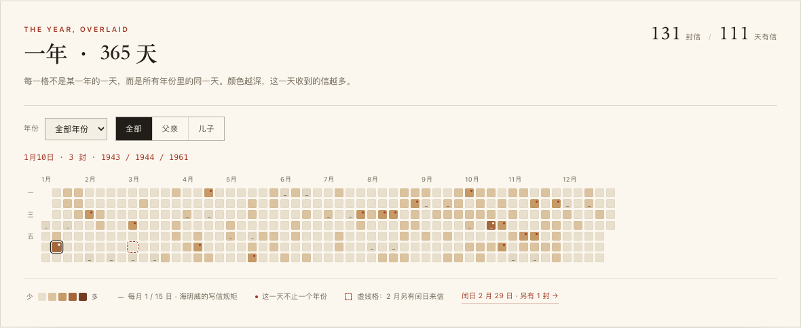
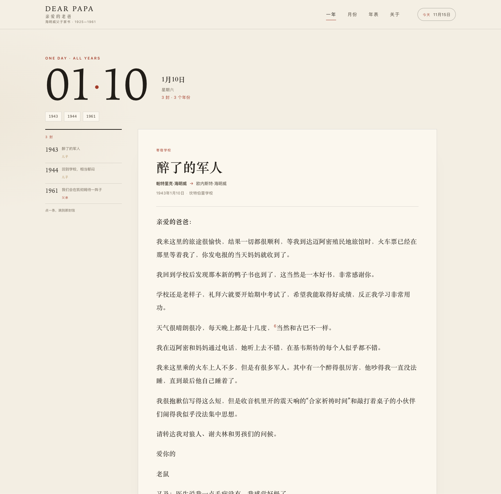
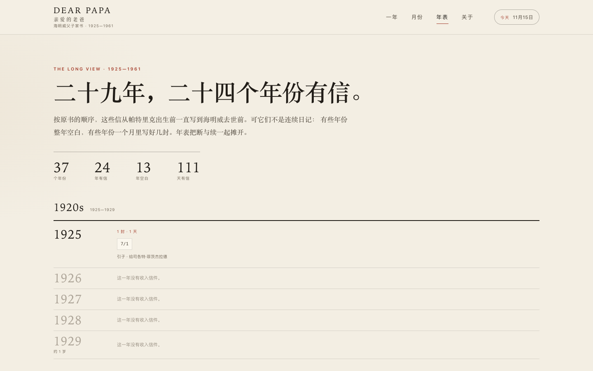

# Dear Papa · 一年

**在线版：https://ewen2015.github.io/dear-papa/**

把《亲爱的老爸：海明威父子家书》重新编排成一本可以按「一年」翻阅的档案。

不是阅读计划，而是一种索引：**固定 365 天，把二十九年里的同一天叠在一起。**

131 封信（130 封父子通信 + 1 封引子），1925—1961。闰日 1952 年 2 月 29 日单独收录，不塞进 365 格。

[](https://ewen2015.github.io/dear-papa/)

*首页。截图中的“今天”会随访问日期变化。*

## 四种读法

### 一年：365 天热力图

[](https://ewen2015.github.io/dear-papa/)

每一格不是某一年的一天，而是所有年份里的同一天。颜色越深，这一天收到的信越多；格子里的小点表示这一天不止一个年份，虚线格表示 2 月另有闰日来信。悬停或键盘聚焦会读出当天所有年份，点开进入「一天」；年份和写信人可筛选。

### 一天：同一天，所有年份

[](https://ewen2015.github.io/dear-papa/#/day/01-10)

以 1 月 10 日为例：1943、1944、1961 年各有一封信。左侧年份栏列出当天所有条目，右侧按年份从上往下读；点年份可以直接跳到对应信件。

### 一个月：先看形状，再读文字

[](https://ewen2015.github.io/dear-papa/#/month/10)

以十月为例：月历的每一格是所有年份里的这一天，数字是当天信件数；带横线的 1 日、15 日是海明威定下的写信规矩。先看这个月的密度，再在下面按日读原文。

### 年表：断与续

[](https://ewen2015.github.io/dear-papa/#/years)

1925—1961 共 37 年，24 年有信，13 年整年空白。空白年份不被隐藏，断与续一起看。

## 几个数字

| | |
| --- | --- |
| 信件 | 131 封（58 封父亲 / 72 封儿子 / 1 封引子） |
| 年份 | 1925—1961，37 年中有 24 年有信 |
| 日子 | 111 天有信，18 天不止一个年份 |
| 字数 | 112,630 字，平均约 860 字一封 |
| 日期推定 | 3 封（月末 / 夏末 / 邮戳） |
| 闰日 | 1 封（1952-02-29） |

## 页面

- `/` 一年：热力图、今日、十二月密度、全书结构
- `#/day/06-21` 一天：这一天所有年份的信
- `#/month` 月份索引；`#/month/10` 单月月历与逐日列表
- `#/years` 年表
- `#/about` 项目说明、日期处理、来源

路由使用 hash，静态托管不需要服务器重写规则。

## 日期处理

365 天骨架取 2026 年（平年），星期一开头。星期几只作骨架参照，不对应原信真实的星期。

大多数信有确切日期。三封信只能推定，为了落格各取一个位置，页面上标「日期推定」：

- 1940 年 4 月末 → 4 月 30 日
- 1942 年夏末 → 8 月 31 日
- 1959 年（邮戳 5 月 12 日）→ 5 月 12 日

落点是索引位置，不是伪造的日期。引用时请以原书为准。

## 开发

需要 Node 20+。

```bash
npm install
npm run parse   # 重新生成 src/data/letters.json
npm run dev
npm run build
npm run lint
```

### 数据管线

```
data/source/dear-papa.txt   EPUB 提取的中文版正文
scripts/parse-book.mjs      解析：章节、收信人、日期、正文、原书注
src/data/letters.json       生成的结构化档案（131 封）
```

解析器处理了 EPUB 提取文本里的页标记、重复标题、章末脚注、照片说明、电报无称呼、近似日期与闰日。跑 `npm run parse` 会打印各章节数量与年份范围。

### 代码结构

```
src/lib/calendar.ts   365 天骨架、53 周热力图、热度等级
src/lib/archive.ts    按日 / 按年索引、相邻有信日、写信人角色
src/lib/stats.ts      月份统计、章节统计
src/lib/router.ts     hash 路由
src/components/      Heatmap、MonthGrid、LetterReading 与各个页面
```

## 来源与版权

中文版：《亲爱的老爸：海明威父子家书》，欧内斯特·海明威、帕特里克·海明威 著；布伦丹·海明威、斯蒂芬·亚当斯 编；姜向明 译；上海译文出版社，2024 年 9 月，ISBN 9787532796298。

英文原书：*Dear Papa: The Letters of Patrick and Ernest Hemingway*。

本项目是个人阅读与研究项目，不代表出版社或海明威遗产委员会。仓库公开后，中文版全文可公开阅读；文字版权归原作者与出版方所有，请勿用于商业传播。原书注保留为「原书注」，方括号［］内为编者补注；引用请以正式出版物为准。
